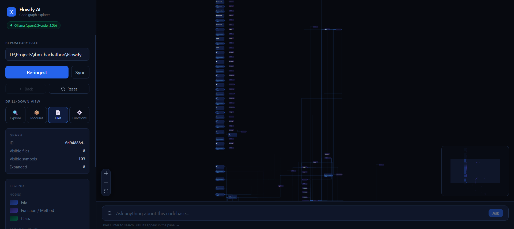
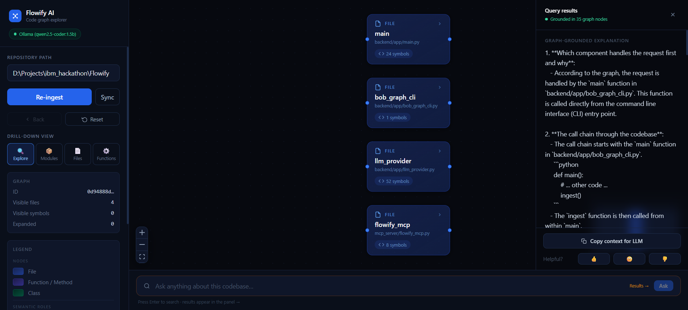

# Flowify AI

> **Know where to look in a change.** Flowify keeps a static flow graph of your whole codebase and ranks every change in a commit or PR by how far it can cascade, so reviewers, human and AI, spend their time on the code that can cause an outage and not on a dead function.

AI coding agents now deliver 1,000+ lines per feature change. Those lines are still reviewed by a developer and an approver, and the attention is spread evenly: a minimal change in a function nothing calls any more costs the same review bandwidth as a change to core logic that can cause a production outage if it is missed. A diff shows what changed, not what depends on it.

Flowify builds a static flow graph of the entire codebase up front and updates it incrementally from git as changes land. For any commit, PR or working-copy change it looks the changed functions up in the graph and finds their upstream and downstream dependencies: if something is wrong here, does it cascade through core paths, or end at a dead end such as a log statement? It lists the changes ranked by criticality, so developers and reviewing AI agents know where to look and where to spend the most time. The same graph helps plan features: explore it interactively before writing code to keep planned changes modular and their blast radius small. The graph is static and resolves roughly half of real calls; calls it cannot pin down are reported as unconfirmed instead of hidden, so a short list is a place to start, never proof of safety ([accuracy](docs/accuracy.md)).

Under the hood, Flowify ingests a codebase through three phases (repo context → AST/semantic enrichment → continuous learning), renders it with ReactFlow, and lets you explore and query it through a dark-themed UI. The LLM backend is fully pluggable — Ollama (local, free) is recommended for development; Claude, OpenAI, GitHub Copilot, and any OpenAI-compatible endpoint are supported — and every graph is also reachable by AI agents through an MCP server and a plain JSON export.

**Live demo**: [flowify-7vcn.onrender.com](https://flowify-7vcn.onrender.com/) — paste a public git URL and explore. Hosted on Render's free tier, so it sleeps after 15 minutes idle (~30-60s cold start on the first request).

---

## Reviewing a change (local checkouts)

1. **Pick**: Review opens on a queue of branches ahead of `main`, ranked by their riskiest change, plus your own working copy.
2. **Triage**: a branch's changes are grouped into *Must check*, *Worth a glance* and *Skim*, under a one-line verdict (must-check count, callers it breaks, untested changes, "could be split").
3. **Verify**: each change leads with static contract checks (a caller that no longer binds, a redefinition, a changed default), optional Claude notes that must quote the code they are about, the diff, and the callers the change did not update. `j`/`k` move, `x` checks, `f` flags.
4. **Finish**: one click marks every low-risk change skimmed; *Finish* copies a review summary for the PR. After the author pushes again, only the changes edited since you checked are shown.
5. **Authors** check their working copy first: run the tests that reach each must-check change, or leave a note, saved to `.flowify/review.json`.

Scoring, checks and limits: [docs/change-risk.md](docs/change-risk.md).

## Features

- **Interactive call graph** — dual-layer graph (function-level + module-level). Drill down from module clusters → source files → individual functions/classes.
- **Human-scale by default** — module lanes are merged to about a dozen, a focused lane shows its 60 most important items (with "Show all"), and importance is a percentile within the repo (top 5% "high"), so it stays meaningful on an 80K-node codebase.
- **Lane overview → focus** — a repo with many top-level modules opens as one card per lane, laid out left to right by call direction (wrapping like text) so the whole architecture fits one screen. Select a lane to open it in full, with the lanes it calls and is called by as neighbouring cards you can hop between; a sidebar **Lanes** list and the **Overview** breadcrumb keep navigation one click away. Repos with only a few roots keep the classic stacked view.
- **Dry-run trace** — pick where a request or command starts (API endpoints and entry functions are suggested, or search by name) and Flowify walks everything it calls, in the order the code calls it, across files and modules. Each step is tagged with the control flow it sits in (`if / else`, `loop`, `try`, `on error`), module crossings are marked, repeats and cycles are shown instead of followed, and calls the graph could not pin to one target are counted as *ambiguous* rather than hidden. Step through it one function at a time, or view the whole path at once; copy it as text for a review or an LLM. The trace tree shows a bounded number of steps (fan-out shrinks with depth), so it stays readable on any repo.
- **Measured accuracy** — the call graph is scored against what really runs (a repo's own test suite under a call tracer): about 96% of the edges the tests could judge are correct on click and jinja, 83% on flask, and the graph contains roughly half of the calls that really happen. Every edge shows its confidence and why it was chosen, and change-impact analysis lists *possible callers* the graph could not resolve. Method, per-tier numbers and limits: [docs/accuracy.md](docs/accuracy.md); reproduce with `benchmarks/accuracy/measure.py`.
- **Per-node descriptions** — every node shows a one-line description of what that function/class/module does, derived from its docstring or code via AST analysis (or an LLM when one is configured).
- **Semantic edge types** — edges are colour-coded: blue = CALLS, green = EXPOSES_API, purple = USES_DB, yellow = EMITS_EVENT, red = CONSUMES_EVENT.
- **Change Impact analysis** — type a function under *Find a Function* (or click it) to see who depends on it: direct callers, every upstream dependent, callers the graph could not confirm, and a triage risk level (low → critical) that only ever rises with missing evidence. *Copy Link* shares it. A PR version runs from the CLI or GitHub Action: `python backend/app/pr_impact.py --repo . --base origin/main` (see `.github/workflows/pr-impact.yml`).
- **Graph-grounded NLP queries** — ask questions in plain English; answers are anchored to real graph traversal with a "Grounded in N nodes" badge, numbered call-chain steps, and 👍/😐/👎 feedback. Call edges are resolved through a scoped, confidence-ranked matcher (self-call → attribute type → receiver class → module import → same-file → unique-repo-wide), not simple name matching — an ambiguous call is dropped rather than guessed, so the cited call chain reflects edges that actually exist.
- **Continuous learning** — query patterns and feedback adjust relevance scores and build a terminology map over time.
- **Scales to large repos** — viewport culling, memoized nodes, and hover handling that only touches the nodes it affects keep the graph view responsive well past a thousand nodes; a whole-repo view is capped at 600 rendered nodes (highest-degree kept) with an on-screen "Showing N of M" banner instead of silently truncating or freezing the tab.
- **Guarded ingest on small hosts** — on a hosted (`server`) instance, oversized repos are rejected fast with a clear message instead of crashing the process; see [Ingest limits](#ingest-limits).
- **Accessible UI** — labelled dialogs with focus trap and Escape, keyboard-operable lane cards and tabs, live regions for loading/errors, `prefers-reduced-motion` honoured.

---

## Screenshots

### Graph exploration — drill-down from files to functions

After ingestion the graph loads instantly. The **Jump to a Level** selector (Explore · Areas · Functions) switches abstraction levels; Areas are groups found from call patterns, not folders. Each node card shows the file/function name, path, symbol count, and a code-based one-line description.



### Natural-language queries with graph-grounded answers

Ask any question about the codebase. The answer is grounded in real graph traversal — every response shows which nodes were consulted, numbered execution steps, and a **Copy context for LLM** export button.



---

## Quick start

### One-command launch (recommended)

```bash
bash run.sh          # starts backend + frontend → http://localhost:5173
bash run.sh --test   # same, plus smoke-tests every API endpoint
```

### Manual

```bash
# Backend
cd backend
python -m venv .venv && source .venv/bin/activate   # Windows: .venv\Scripts\activate
pip install -r requirements.txt
python -m uvicorn app.main:app --host 127.0.0.1 --port 8000 --reload --reload-dir app

# Frontend (separate terminal)
cd frontend
npm install
npm run dev
```

Frontend → http://localhost:5173 · Backend → http://localhost:8000 · Swagger → http://localhost:8000/docs

---

## LLM providers

### Ollama — recommended for local development

Install [Ollama](https://ollama.com), pull a code model, start the server, and Flowify auto-detects it:

```bash
ollama pull qwen2.5-coder:1.5b   # ~1 GB, fast on CPU
# or larger models:
# ollama pull codellama           # 4 GB
# ollama pull deepseek-coder      # 7 GB

# Ollama starts automatically after install, or run manually:
ollama serve
```

Flowify tries models in this priority order (picks the first installed):
`codellama → deepseek-coder → qwen2.5-coder → llama3.x → mistral → phi3 → gemma2`

Override with env vars:
```bash
OLLAMA_HOST=http://localhost:11434   # default
OLLAMA_MODEL=codellama               # force a specific model
```

### Ollama Cloud

Point `OLLAMA_HOST` at `https://ollama.com` and set `OLLAMA_API_KEY` to use Ollama's hosted models instead of a local install — this is what the live demo runs. `OLLAMA_MODEL` is required in this mode (there's no local "installed models" list to auto-pick from).

### Bring your own key (BYO)

A hosted instance can run with **no server-side LLM key at all** (`LLM_PROVIDER=heuristic`) while still giving each visitor real LLM answers if they supply their own. Any request carrying an `X-Flowify-Provider` header gets that provider for every LLM call made while handling it — ingest, query, module summaries — via headers only, no server restart or config change:

| Header | Purpose |
|---|---|
| `X-Flowify-Provider` | `ollama` \| `anthropic` \| `openai` (required to opt in) |
| `X-Flowify-Api-Key` | Your key for that provider |
| `X-Flowify-Model` | Optional model override |
| `X-Flowify-Base-Url` | Optional endpoint override (self-hosted Ollama, OpenAI-compatible proxy, etc.) |

The key lives only in that request's context and is never logged or persisted. Note: on the hosted demo, **ingestion always uses the deterministic heuristic provider regardless of this header** — a single ingest can make dozens-to-hundreds of LLM calls, which would blow through a per-visitor key's rate limits fast; BYO keys apply to query and flow-summary generation, the two per-visitor (not per-repo) LLM touchpoints.

### All providers

| `LLM_PROVIDER` value | Provider | Required env var(s) |
|---|---|---|
| *(unset)* | **Auto-detect** — Ollama first, then cloud keys | — |
| `ollama` | Ollama (local) | *(none — just needs `ollama serve`)* |
| `claude` | Anthropic Claude | `ANTHROPIC_API_KEY` |
| `openai` | OpenAI | `OPENAI_API_KEY` |
| `copilot` | GitHub Copilot | `GITHUB_TOKEN` |
| `openclaw` | OpenClaw | `OPENCLAW_API_KEY`, `OPENCLAW_API_URL` |
| `heuristic` | No LLM — stubs only (fast, offline) | *(none)* |

### LLM cache

All provider responses are cached to `_store/llm_cache/` keyed by SHA256 of the prompt. The first ingestion of a large repo may take minutes (Ollama makes one call per function); subsequent runs are instant. Delete cache files manually to force re-summarisation.

---

## Environment variables

| Variable | Default | Purpose |
|---|---|---|
| `LLM_PROVIDER` | *(auto-detect)* | Provider selection (see table above) |
| `OLLAMA_HOST` | `http://localhost:11434` | Ollama server URL (`https://ollama.com` for Cloud) |
| `OLLAMA_MODEL` | *(auto-pick best installed)* | Force a specific Ollama model (required for Cloud) |
| `OLLAMA_API_KEY` | *(unset)* | Ollama Cloud API key, sent as `Authorization: Bearer` |
| `ANTHROPIC_API_KEY` | *(unset)* | Anthropic Claude API key |
| `ANTHROPIC_MODEL` | `claude-3-5-haiku-20241022` | Claude model |
| `OPENAI_API_KEY` | *(unset)* | OpenAI API key |
| `OPENAI_MODEL` | `gpt-4o-mini` | OpenAI model |
| `GITHUB_TOKEN` | *(unset)* | GitHub token for Copilot |
| `OPENCLAW_API_KEY` | *(unset)* | OpenClaw API key |
| `OPENCLAW_API_URL` | *(unset)* | OpenClaw endpoint |
| `FLOWIFY_STORE` | `./_store` | Graph + cache storage directory |
| `FLOWIFY_MODE` | `local` | `local` (desktop use) or `server` (hosted deploy) — see [Deployment](#deployment) |
| `FLOWIFY_FRONTEND_DIST` | *(unset)* | Path to a built `frontend/dist`; if set, the backend serves it at `/` |
| `FLOWIFY_ALLOWED_ROOTS` | *(unset)* | `server` mode only: `os.pathsep`-separated local paths ingest is allowed to read |
| `FLOWIFY_WORKDIR` | system temp dir | Where git-URL clones are made before ingest, then deleted |
| `FLOWIFY_MAX_CLONE_MB` | `100` | Reject a git-URL clone larger than this (clones are shallow, `depth=1`, regardless) |
| `FLOWIFY_CORS_ORIGINS` | `*` | Comma-separated allowed origins |
| `FLOWIFY_GRAPH_TTL_H` | `24` | `server` mode only: delete graphs older than this many hours |
| `FLOWIFY_RATE_LIMIT_PER_MIN` | `6` | `server` mode only: per-IP cap on ingest/query calls |
| `FLOWIFY_LLM_CALLS_PER_DAY` | `300` | `server` mode only: global daily cap on query/flow-summary LLM calls — protects a shared server-side key from being drained by many visitors; returns 429 once hit |
| `FLOWIFY_MODULARITY_LIMIT` | `800` | Above this many code-symbol nodes in one connected component, module clustering skips community detection and groups by directory instead (much cheaper, avoids OOM on large repos) |
| `FLOWIFY_MAX_SOURCE_BYTES` | `157286400` (150 MB) | `server` mode only: reject a repo whose supported source files total more than this, before any parsing starts |
| `FLOWIFY_EXCLUDE_DIRS` | `server`: `tests,test,__tests__,spec,benchmarks,benchmark,examples,example,docs,doc,scripts`; `local`: none | Comma-separated directory names skipped during parsing (empty string = skip nothing). Including `tests` also skips `test_*.py`, `*_test.py` and `conftest.py`. On a large repo this alone removes ~40% of nodes |
| `FLOWIFY_MAX_LANES` / `FLOWIFY_TARGET_LANES` | `20` / `12` | Above this many directory groups, modules are merged by path prefix down to about the target, so the overview stays readable |
| `FLOWIFY_LLM_INGEST_MAX_NODES` | `500` | The LLM ingestion prompt and result describe only this many of the most-connected nodes |
| `FLOWIFY_MAX_NODES` | `20000` | `server` mode only: abort as soon as the running parsed-node count passes this (checked after every file while parsing) |
| `FLOWIFY_MAX_PARSE_SECONDS` | `60` | `server` mode only: abort parsing once it has run this long — CPU, not memory, is the tighter limit on a small free instance |

---

## Deployment

The same codebase runs four ways — see [Dockerfile](Dockerfile) and
[`.github/workflows/`](.github/workflows) for the full setup:

- **Hosted (public site), genuinely free — [Render](https://render.com)** —
  a single Docker image serves the built frontend and the API from one
  origin (`FLOWIFY_MODE=server`). Paste a public git URL; it's cloned to a
  temp dir, ingested, and deleted. No server-side LLM key — graphs are
  built with the deterministic AST-based provider, and the **Copy for
  LLM** export gives a full architecture report to paste into any chatbot
  for free. Graphs are scoped to an anonymous per-browser session and
  expire after `FLOWIFY_GRAPH_TTL_H` hours.

  In the Render dashboard: **New +** → **Blueprint**, point it at this
  repo — [`render.yaml`](render.yaml) configures the rest. No credit card
  required on Render's free plan. (Hugging Face Spaces was the original
  plan here, but as of July 2026 HF requires a PRO subscription to create
  a Docker Space — the free tier is capped at 2 ZeroGPU Spaces, which
  don't fit an always-on server. If you do have HF PRO,
  `.github/workflows/deploy-space.yml` + [`deploy/space_readme.md`](deploy/space_readme.md)
  still work.) Render's free tier sleeps after 15 min idle (~30-60s cold
  start on the next request) and has no persistent disk — both already
  accounted for by the TTL janitor and ephemeral-storage design.
  ```bash
  docker build -t flowify .
  docker run -p 7860:7860 -e FLOWIFY_MODE=server flowify
  ```
  The image installs plain `uvicorn` (not `uvicorn[standard]`) since this
  app runs a single worker with no websocket routes and no `--reload` in
  the container — the extras (`uvloop`, `httptools`, `websockets`,
  `watchfiles`, `python-dotenv`, `pyyaml`) would just add dead weight.
  This trims what gets pulled/started on a cold container, but it doesn't
  remove Render free tier's 15-minute idle spin-down — that ~30-60s cold
  start on the next request is a platform behavior, not an image-size one.
- **Local, one command** — the same image, pointed at your own folder,
  with `/shutdown` enabled and no session scoping:
  ```bash
  docker run -p 7860:7860 -e FLOWIFY_MODE=local -v "$PWD:/repos:ro" ghcr.io/mimo1999/flowify_toolkit
  ```
- **Local, from source** — unchanged: `bash run.sh` (see Quick start above).
- **Frontend only, on Vercel** — connect this repo with Root Directory
  `frontend`, then set `VITE_API_BASE=https://<your-render-service>.onrender.com/api`
  so a statically-hosted frontend talks to a backend running elsewhere.

`.github/workflows/ci.yml` runs the no-server-needed tests, a frontend
build, and a Docker build on every push. `docker-publish.yml` pushes
`ghcr.io/<owner>/<repo>` on version tags — free for public repos, no extra
secret required. `deploy-render.yml` is only needed if you've turned off
Render's default GitHub auto-deploy.

### Ingest limits

On a hosted (`FLOWIFY_MODE=server`) instance three independent guards protect the process, all off in `local` mode:

1. **Source size** — `FLOWIFY_MAX_SOURCE_BYTES`, a directory walk before any parsing (a fraction of a second even for thousands of files).
2. **Node count** — `FLOWIFY_MAX_NODES`, checked after every file, so a dense repo is rejected as soon as it crosses the line rather than after a full parse.
3. **Parse time** — `FLOWIFY_MAX_PARSE_SECONDS`, likewise checked per file.

A rejection returns HTTP 413 with the measured value, the limit that was hit, and the local-ingest escape hatch. `GET /limits` reports the active thresholds so a client can warn before submitting. The defaults are reasoned estimates for a 512 MB / shared-CPU instance, not measured values for your host — tune them after ingesting a few real repos.

---

## Architecture

Flowify runs in three phases:

```
repo_path
  → ingestion.py          (language detection, file walk)
  → llm_provider.py       (analyze_repository, summarize_function, analyze_semantics)
  → graph_builder.py      (AST → CIR nodes/edges, multi-language)
  → module_abstractor.py  (community detection → module nodes)
  → storage.py            (SQLite at $FLOWIFY_STORE/flowify.db)
  → llm_ingestion.py      (LLM validation/enrichment of AST-derived node JSON)
  → retrieval.py          (query → graph BFS traversal)
  → learning.py           (feedback loop, terminology map)
```

**Phase 1 — Repo context** (`llm_provider.py`'s `analyze_repository`): analyses README, manifests, directory tree; detects project type, tech stack, entry points, architecture pattern.

**Phase 2 — Semantic enrichment** (`graph_builder.py` + `llm_provider.py` + `llm_ingestion.py`): multi-language AST parsing (Python, JS/TS, Java, C/C++) → Canonical Intermediate Representation (CIR) → per-function LLM summaries (intent, complexity, criticality) → `llm_ingestion.py` validates/enriches the AST-derived node JSON. Module clustering via greedy modularity community detection (NetworkX).

**Phase 3 — Continuous learning** (`learning.py`): tracks query patterns and feedback; adjusts relevance scores; builds a terminology map.

### Semantic edge types

| Edge | Colour | Meaning |
|---|---|---|
| `CALLS` | Blue | Direct function call |
| `EXPOSES_API` | Green | HTTP / RPC endpoint |
| `USES_DB` | Purple | Database read/write |
| `EMITS_EVENT` | Yellow | Event / message publish |
| `CONSUMES_EVENT` | Red | Event / message subscribe |

### Graph storage

- Graphs: stored in a SQLite database at `$FLOWIFY_STORE/flowify.db` — `{graph_id}` is a 12-char hex from `uuid4().hex[:12]`
- MCP repo IDs: 12-char hex from SHA256 of `repo_path` — **different from graph IDs**
- Override store location with `FLOWIFY_STORE` env var

---

## API reference

Every route below is available both at its path as written (kept for
backward compatibility with the MCP server and existing tests) and under an
`/api` prefix (e.g. `/api/ingest_repo`) — the path production deployments
and the built frontend use. See the router-mounting comment at the top of
[`backend/app/main.py`](backend/app/main.py).

### UI-facing endpoints

| Method | Path | Body / Params | Returns |
|---|---|---|---|
| `POST` | `/ingest_repo` | `{repo_path}` **or** `{repo_url}` | `{graph_id, function_count, module_count}` |
| `GET` | `/entry_points` | `?graph_id=&max_count=4` | Root file nodes for the initial view |
| `GET` | `/expand` | `?graph_id=&node_id=&action=callees\|functions` | `{children, edges}` |
| `GET` | `/graph` | `?graph_id=&depth=1..3` | Full graph at the requested depth |
| `GET` | `/trace_path` | `?graph_id=&source=&target=` | Shortest call chain between two functions, in the `/trace` step format (`stats.found` is false when none exists) |
| `GET` | `/trace_starts` | `?graph_id=&q=&limit=` | Suggested trace starts (entry points ranked by reach), or a name search when `q` is set |
| `GET` | `/trace` | `?graph_id=&start=&max_depth=6&max_steps=80&fanout=6` | Source-ordered dry run from `start`: steps with depth, call line, control-flow context, module, ambiguous calls |
| `GET` | `/impact` | `?graph_id=&node_id=` | Change impact analysis for a function |
| `POST` | `/query` | `{graph_id, query}` | `{explanation, execution_steps, graph_nodes_consulted}` |
| `POST` | `/feedback` | `{graph_id, query_id, rating}` | Feedback (feeds continuous learning) |
| `POST` | `/update` | `{graph_id}` | Re-ingests changed files via git diff |
| `GET` | `/provider_info` | — | Active LLM provider name + model |
| `GET` | `/limits` | — | Active ingest thresholds (`null` outside server mode) |

### Analysis endpoints

| Method | Path | Returns |
|---|---|---|
| `GET` | `/repo_context?graph_id=` | Phase 1 repository analysis |
| `GET` | `/semantic_analysis?graph_id=` | Per-function semantic metadata |
| `GET` | `/analytics?graph_id=` | Query usage statistics |
| `GET` | `/hot_nodes?graph_id=&limit=10` | Most-queried functions |
| `GET` | `/module_details?graph_id=&module_id=` | Module with control-flow groups |

### Knowledge & analytics endpoints (deterministic, zero LLM calls)

| Method | Path | Returns |
|---|---|---|
| `GET` | `/knowledge/{graph_id}` | Docs (README/ADR/RFC/wikis) as nodes, linked to the code they reference, each edge with provenance (source/confidence/evidence) |
| `GET` | `/node_references?graph_id=&node_id=` | Everything the knowledge layer knows about one node — referencing docs, TODO/FIXME/HACK/WHY rationale in its source span, call-edge provenance |
| `GET` | `/graph_analytics/{graph_id}?refresh=` | Centrality metrics, god nodes, cycles, articulation-point bridges, functions with no static callers (not the same as unused; measured in docs/accuracy.md), surprising cross-module couplings |
| `GET` | `/architecture_report/{graph_id}?format=markdown\|json` | The full GRAPH_REPORT.md architecture report |

All four auto-build their metadata on demand for graphs ingested before the feature existed, and are cached at ingest time otherwise.

### MCP endpoints (for LLM assistants)

| Method | Path | Notes |
|---|---|---|
| `POST` | `/mcp/ingest` | Idempotent; returns stable `repo_id` from SHA256 of path |
| `POST` | `/mcp/query` | Structured function list + execution path |
| `POST` | `/agent/graph` | Full agent-ready graph payload (CLI / agent use) |
| `GET` | `/mcp/find_node?graph_id=&name=` | Find code nodes by (partial) name, with summaries |
| `GET` | `/mcp/shortest_path?graph_id=&source=&target=` | Shortest call path between two functions, addressed by name |
| `GET` | `/mcp/search_rationale?graph_id=&query=&marker=` | Search extracted TODO/FIXME/HACK/WHY/NOTE comments |
| `GET` | `/mcp/dead_code?graph_id=` | Functions with zero inbound call edges (candidates — dynamic dispatch can false-positive) |
| `GET` | `/mcp/hotspots?graph_id=` | God nodes, critical bridges, high-risk components |
| `GET` | `/mcp/cycles?graph_id=` | Circular dependencies and surprising cross-module couplings |
| `GET` | `/mcp/architectural_summary?graph_id=` | The architecture report as Markdown, for agent consumption |

---

## MCP server (VS Code integration)

```powershell
cd mcp_server
.\setup.ps1        # registers the MCP server into VS Code
# restart VS Code, then ask your AI assistant: "What tools do you have available?"
```

Agent CLI (from `backend/`):

```bash
python -m app.graph_cli --repo-path /path/to/repo --depth 3
```

See [`mcp_server/README.md`](mcp_server/README.md) for full setup details.

---

## Running tests

```bash
# Run from project root (NOT from tests/ — relative imports will break)
pytest tests/ -v

# Individual suites
pytest tests/test_mcp_endpoints.py -v       # no server needed
pytest tests/test_integration.py -v         # requires FastAPI on :8000
pytest tests/test_self_graph.py -v          # ingests this repo itself
```

---

## Windows notes

- **B:\ drive error dialog**: `uvicorn --reload` uses watchfiles which enumerates all drive letters on Windows. Scope it to the app directory to prevent the error:
  ```bash
  python -m uvicorn app.main:app --host 127.0.0.1 --port 8000 --reload --reload-dir app
  ```
  `run.sh` and `start_server.ps1` already include this flag.

- **Long first-ingestion time**: Ollama makes one LLM call per function during ingestion. A 600-function repo can take 10–20 minutes on first run. All responses are cached — subsequent runs are instant. Use `LLM_PROVIDER=heuristic` for a no-LLM fast ingest.
